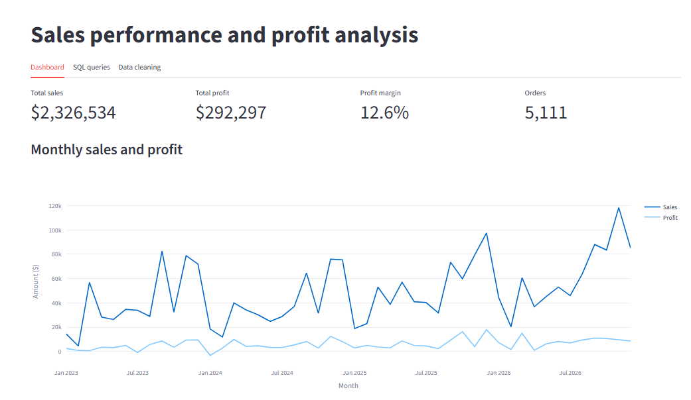
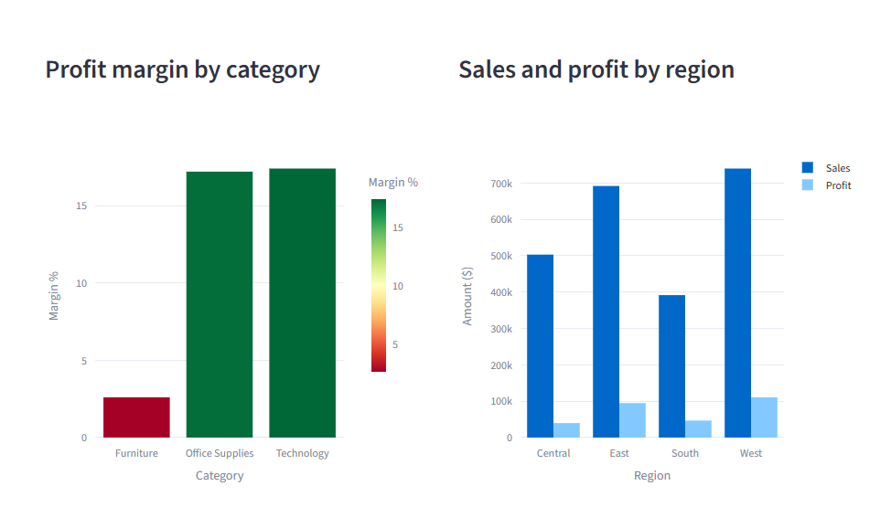
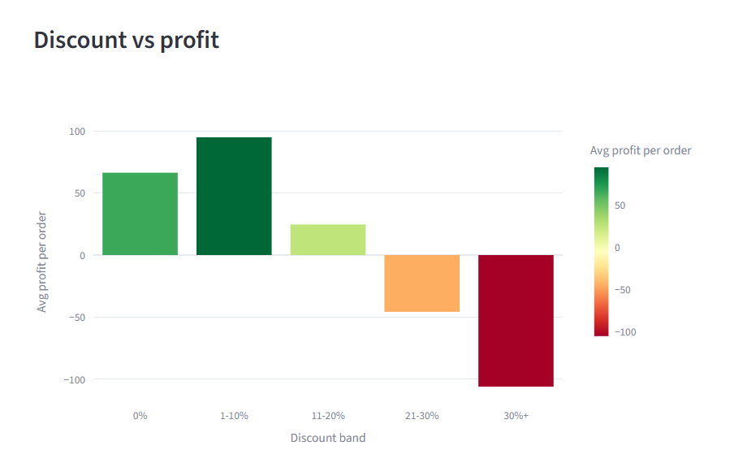
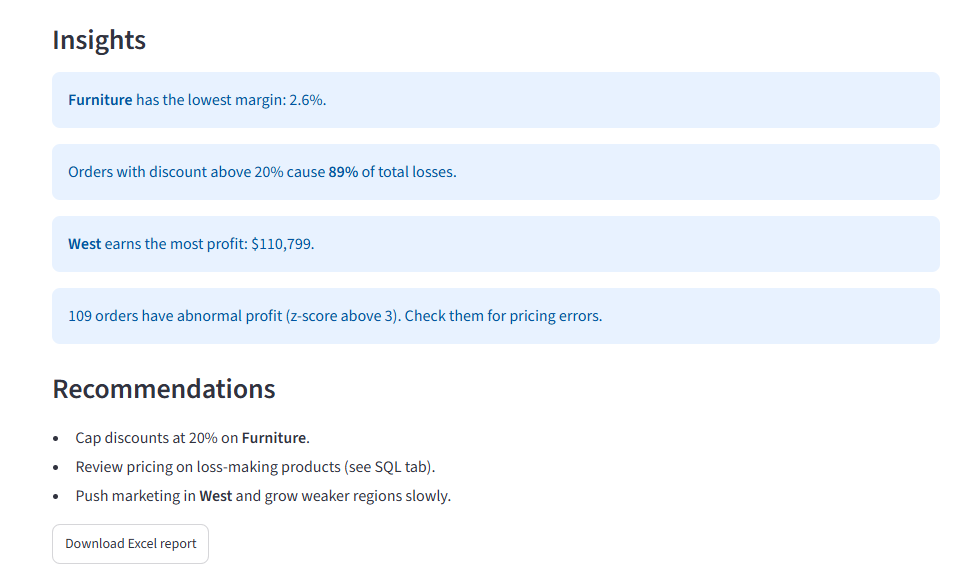

# Sales performance and profit analysis dashboard

**Live demo:** https://prasanna-sales-dashboard.streamlit.app

Interactive Streamlit dashboard that shows where a retail company makes money and where it loses it.
Built on the Superstore sales dataset (10,194 order lines, 5,111 orders, $2.33M sales).

**Tech:** Python, Pandas, NumPy, SQL (SQLite), Excel (OpenPyXL), Streamlit, Plotly



## What it does
- Upload an orders file (CSV or Excel) or use the default data
- Automatic cleaning: duplicates, invalid dates, nulls
- KPIs: sales, profit, margin %, orders; monthly trend
- Charts: category margin, region performance, discount vs profit
- Auto insights and recommendations (NumPy z-score flags abnormal orders)
- SQL tab: GROUP BY, HAVING, RANK() and running-total window functions
- Excel report download

## Key findings
- Overall margin is 12.6% ($292K profit on $2.33M sales).
- **Furniture** has similar sales to other categories ($755K) but only a 2.6% margin, against about 17% for Office Supplies and Technology.
- **Tables** lose money: sales of $208K but a loss of $17.8K.
- **Discounts drive losses:** orders with discount above 20% are 13.9% of order lines but cause 89% of total losses. Orders with 30%+ discount lose $106 on average; orders with no discount earn $66.
- **Central** region has a 7.9% margin against 15% in West.
- Worst states by profit: Texas (-$25.7K), Ohio (-$17.0K), Pennsylvania (-$15.6K).





## Recommendations
1. Cap discounts at 20%, starting with Furniture.
2. Review pricing for Tables and Bookcases.
3. Review discount policy in Central region and in Texas, Ohio and Pennsylvania.

## Run locally
```
pip install -r requirements.txt
streamlit run app.py
```
Needed columns: Order ID, Order Date, Region, Category, Product Name, Sales, Discount, Profit.
